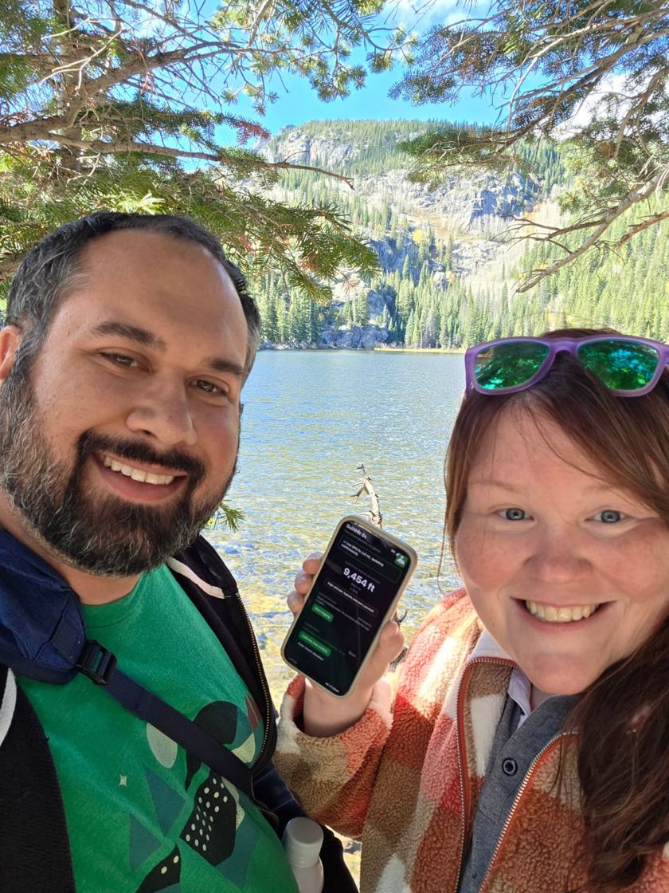

# Summit Benchmark

An offline-first PWA that shows your **current elevation** at a glance and logs it
over time. Built so you can keep an eye on altitude in the mountains without a cell
signal.

## Why

Planned for a trip to Yellowstone, Grand Teton, and Rocky Mountain National Parks.
The immediate need is peace of mind about **altitude sickness**: a dead-simple,
always-available readout of "how high are we right now?" so we can correlate
elevation with how we're feeling and decide when to head lower. The secondary goal
is logging elevation across a day of exploring and charting it.

Those parks have long stretches with no cell service, so the app is designed to be
installed to the home screen and run **fully offline**. GPS itself is satellite-based
and works without a signal; only loading the page needs caching, which a service
worker handles.

The name nods to a surveying **benchmark**, a fixed point of known elevation (the
kind literally set into mountain summits), and to the app's "calibrate here"
feature, which uses exactly that idea.

## On the trip (October 2026)

  

The app came along and got real use. Nicole used it throughout the trip, and a quick
answer to "how high are we right now?" did what it was built for: it took some of
the worry out of the altitude. We both felt the elevation and took things slowly, but
made it to Bear Lake in Rocky Mountain National Park, the highest point we reached.
The app read **9,454 ft** there, and the National Park Service lists the Bear Lake
trailhead at 9,475 ft, so it was within about 20 ft.

We logged the drive up to Estes Park (that session is still on the phone, waiting for
the export feature), and pocket mode worked on the iPhone: the screen stayed on with
the dim readout, and the hold-to-unlock ring worked.

### The one real bug: stuck on the splash screen

On the Galaxy S25 Ultra, the app sometimes stuck on its splash screen when the signal
was weak, while the iPhone always opened. The cause was in the service worker, which
was network-first with no timeout. With no connection at all, a request fails right
away and the app loads from its offline cache. A weak or flickering signal makes the
request hang instead of fail, so the cached copy was never used. Our best explanation
for why only the Android phone was affected is that iOS gives up on a marginal
connection sooner.

The fix gives the network 5 seconds before serving the cached app, and once one
request has timed out, the rest of the app loads from the cache without waiting
again. We tested it in headless Chrome against a local server that accepts requests
and never answers, a stand-in for a weak signal. Before the fix the app never loaded;
after it, the app shows in about 5 seconds. It still loads instantly when fully
offline and still picks up a new deploy on the next open when online.

## Status

Working PWA, deployed and installable at **https://summit-benchmark.netlify.app**.

Built so far:

- App shell that installs to the home screen and runs offline (service worker,
  network-first so a new deploy reaches installed devices without a stale-cache lag,
  with a 5 second timeout so a weak signal falls back to the cached app).
- Live elevation readout from `navigator.geolocation.watchPosition()`, smoothed with
  a rolling median so it does not flicker while you stand still.
- Sea-level calibration in two modes: a one-tap lookup against USGS ground truth
  (EPQS) when online, or a hand-entered known elevation offline. The offset persists
  in `localStorage` and one calibration holds across a region.
- A coarse altitude-sickness band cue that flags the high, very high, and extreme
  bands as you climb.
- An elevation log: start/stop sessions that save a reading every 15 seconds to
  IndexedDB on the device. Each reading keeps the raw altitude plus the calibration
  offset in effect, so a later recalibration loses nothing. A session left running
  when the app is closed resumes on the next open.
- Pocket mode for continuous logging. A web app cannot use GPS in the background:
  when the screen locks or you switch apps, the phone suspends the page and logging
  pauses. Pocket mode holds a screen Wake Lock and covers the app with a black
  overlay that ignores touches, so the phone can ride in a pocket and keep logging.
  On an OLED screen black pixels are off, so the display itself costs little.
  Unlocking takes two steps (tap, then hold a circle for 2 seconds) so pocket
  contact cannot trigger it.

Still to come: JSON/CSV export and import, then charting a session's elevation with
uPlot.

## Device compatibility test

Before committing to the build, we verified that the browser Geolocation API actually
reports altitude on the phones we'll carry. That test lives in
[`tools/altitude-test/`](tools/altitude-test/), a single self-contained HTML page
that streams `navigator.geolocation.watchPosition()` and displays altitude, its
accuracy, and whether the device provides it at all.

How to run it: geolocation requires a *secure context* (HTTPS), and a phone can't use
the `localhost` exemption, so the page must be served over HTTPS. We used
[Netlify Drop](https://app.netlify.com/drop) (drag the `tools/altitude-test/` folder,
get an instant HTTPS URL) and opened it on each phone **outdoors** for a real GPS fix.
A live copy of that test is here: **https://silver-gnome-c9e679.netlify.app/**

### Results (2026-08-29)

Ground truth from the USGS EPQS elevation service for the test location (Twin Cities
metro, MN; exact coordinate withheld) was about **903 ft (275 m)** above sea level.

| Device | Reported elevation | vs. USGS truth |
|---|---|---|
| USGS ground truth (orthometric / MSL) | 903 ft | reference |
| iPhone 15 Pro | 890 ft | 13 ft low |
| Galaxy S25 Ultra | 816 ft | 87 ft low |

Both phones report altitude, so the feasibility gate passed. The roughly 74 ft gap
between them is not GPS noise; it is a **reference-frame difference**:

- **iOS returns orthometric height** (above mean sea level). It is geoid-corrected, so
  it matches trail signs and maps almost exactly.
- **Android returns raw ellipsoidal height** (above the WGS84 ellipsoid), which sits
  about 30 m (100 ft) below sea level at this latitude. That offset is the *geoid
  separation*.

So the real build normalizes everything to sea level through calibration. Because the
geoid separation varies by location (the roughly 32 m offset measured here is smaller
out in the mountain west), a single bundled correction would be wrong at the
destination. Instead the app calibrates against a known elevation: a one-tap lookup
against USGS ground truth when online, or a hand-entered value offline. That cancels
geoid separation and device bias in one step, and one calibration holds across a whole
region. (One more note: Android returns `null` for *altitude accuracy* even when
altitude itself is fine, which is cosmetic only.)

## Tech

Vanilla JS, no framework, no build step. Static site on Netlify, which provides the
HTTPS a PWA requires and lets us set cache headers (GitHub Pages would also work).
The service worker handles offline use, calibration state lives in `localStorage`,
and the elevation log lives in IndexedDB (`db.js`, a small promise wrapper with no
dependencies). Still to add: a small vendored charting library (uPlot) for the graphs.

---

*This project has been developed with AI assistance (Claude Code).*
